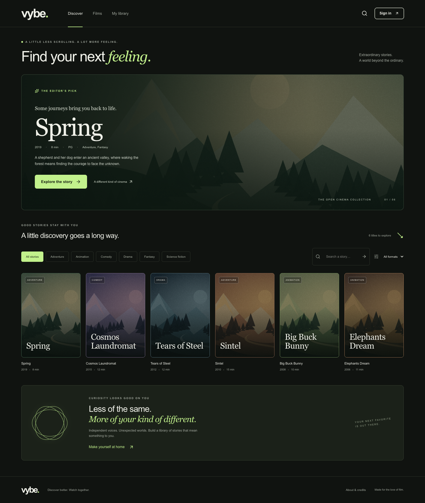
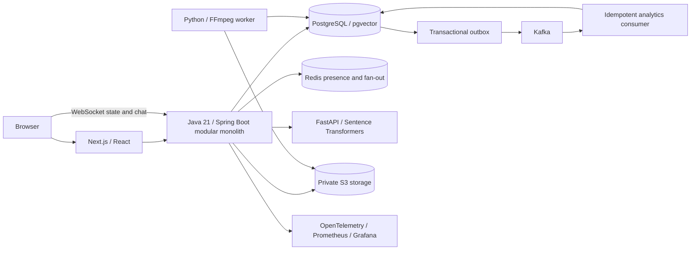

# VYBE · Web V1

**Discover better. Watch together.**

A functional streaming portfolio product with an original cinematic interface, private HLS media, semantic discovery and synchronized screening rooms. Web V1 covers development phases 1–5. SwiftUI belongs to a later release and has not been started. See [verification](docs/verification.md) for executed tests and deployment limitations.



## Implemented product

- Verified registration, email recovery, cookie sessions, CSRF, rate limits, roles and audit records.
- Five viewing profiles with editing/deletion, personal library, history/resume and collaborative watchlists with expiring invitations and owner permissions.
- Films, series/seasons/episodes, genres, credits, artwork uploads and curated collections.
- Actual private S3 upload, leased FFmpeg jobs, HLS quality selection, multiple audio tracks, subtitles and per-asset playback progress.
- Real Sentence Transformers embeddings, PostgreSQL full-text/pgvector discovery, metadata constraints and match explanations. Text fallback when the model service is unavailable.
- Explainable recommendations using ratings, preferences, saved titles, completed viewing, search signals, popularity and embedding similarity. Hide results and reset signals.
- Watch Parties: host permissions, synchronized playback, drift correction, chat/reactions, presence, reconnection, invitations and expiration. VYBE Match combines participant preferences and votes with a fairness-weighted ranking.
- Content/episode/artwork/collection administration, processing retries, user permissions and disabling accounts while protecting the last enabled administrator.
- Personal and platform analytics from recorded data. Kafka transactional outbox, idempotent consumers, retries and dead-letter handling. Structured logs, request IDs, OpenTelemetry integration, Prometheus metrics and Grafana configuration.

## Architecture



Java remains a modular monolith. PostgreSQL is authoritative; Redis shares room events/presence. Python handles media and embedding computation. Kafka is asynchronous and does not gate normal APIs. ADRs and module boundaries are under `docs/`.

## Repository and stack

`apps/web`: Next.js, React, strict TypeScript, TanStack Query, Zustand, Tailwind, RHF/Zod, Motion and hls.js. `apps/api`: Java 21, Spring Boot, Spring Security, JDBC/JPA, Flyway and independent Maven build. `apps/media-worker`: Python/FFmpeg. `apps/ai-service`: FastAPI/Sentence Transformers. `infrastructure`: local services, scripts and monitoring. SwiftUI is deferred.

## Local setup

Docker/Compose, adequate memory/disk and network access for initial model/image downloads are required for the container setup. The complete Compose stack has not been executed on the original workstation because its Docker daemon did not respond; the services were exercised independently.

```sh
cp .env.example .env
docker compose up --build -d
# Explicit local demo seed only:
docker compose exec -T postgres psql -U vybe -d vybe < infrastructure/scripts/seed-demo.sql
```

Web: localhost:3000. Mailpit: localhost:8025. API readiness: localhost:8080/actuator/health/readiness. Grafana: localhost:3001 (`admin`, password `GRAFANA_PASSWORD`). Prometheus: localhost:9090. Compose passwords and scrape token are local examples; replace them before hosted use. Demo films contain attributed metadata and original SVG artwork, not copied video files.

Register through the browser, verify via Mailpit, and explicitly grant the first administrator with `infrastructure/scripts/grant-admin.sh`. Subsequent permissions are managed in Studio. Seeding/admin grants never run automatically in production.

Without Docker, run PostgreSQL with vector extension, Redis, SMTP, private S3, API, FFmpeg worker, AI service and Next.js as separate processes. Supply `.env.example` values to each process; Java does not load a root .env automatically. Install Python requirements separately for the two Python apps. Run AI with `uvicorn main:app --host 127.0.0.1 --port 8001` from apps/ai-service. Set KAFKA_ENABLED=true only with a reachable broker; otherwise events remain queued.

```sh
npm ci
npm run dev
# Separate terminal:
cd apps/api
./mvnw spring-boot:run
# From repository root, another terminal:
python apps/media-worker/worker.py
```

The original workstation uses build/runtime copies in `~/Library/Caches/vybe-build` because iCloud offloads Documents files. Canonical source remains this repository. Ignored caches/symlinks are unnecessary in a fresh checkout. Never overwrite a JAR while its process runs; use a separate runtime copy.

## Tests

```sh
npm run typecheck
npm test
npm run build
cd apps/api
./mvnw verify
```

Backend tests use real PostgreSQL/pgvector, Redis and embedded Kafka. For external local services, set TEST_DATABASE_URL=jdbc:postgresql://localhost:5432/vybe_test and TEST_DATABASE_USER/PASSWORD. Tests refuse external database names other than vybe_test and truncate only that dedicated test database. With Docker they use Testcontainers.

Run `python -m unittest -v` inside apps/media-worker for real FFmpeg tests. Browser tests require running web/API/database/Redis/SMTP/S3:

```sh
MEDIA_FIXTURE=/tmp/vybe-fixture.json python infrastructure/scripts/check-media.py
MEDIA_FIXTURE=/tmp/vybe-fixture.json npm run e2e
```

The harness generates original two-audio movie/episode media, uploads/processes it, adds captions and verifies HLS/progress/access controls. The fixture contains generated test credentials (0600); never commit it. Without it, media/social tests explicitly skip. CI creates it. Install Playwright Chromium or use PLAYWRIGHT_CHANNEL=chrome. Remote GitHub Actions execution is not claimed.

## Operations and limits

See [operations](docs/operations.md), [deployment](docs/deployment/README.md), [media](docs/media.md), [performance](docs/performance.md) and [verification](docs/verification.md).

V1 limits uploads to 250 MB/four hours, rooms to sixteen profiles/four hours, owned lists to twenty/profile and collaborators to twenty/list. Admin catalog listing caps at 200 records. Personal viewing time is an estimate from saved playback movement, not billing-grade attention measurement. Storage metrics count uploaded originals, excluding renditions/provider overhead.

No cloud deployment or production capacity claim is made. Complete Docker/monitoring execution, public HTTPS cookies/WebSocket routing, CDN/media transfer limits, SMTP and backup recovery need hosting-environment validation. Commercial DRM needs licensed infrastructure. SwiftUI/native downloads are outside web V1. Provider services are not assumed free.
