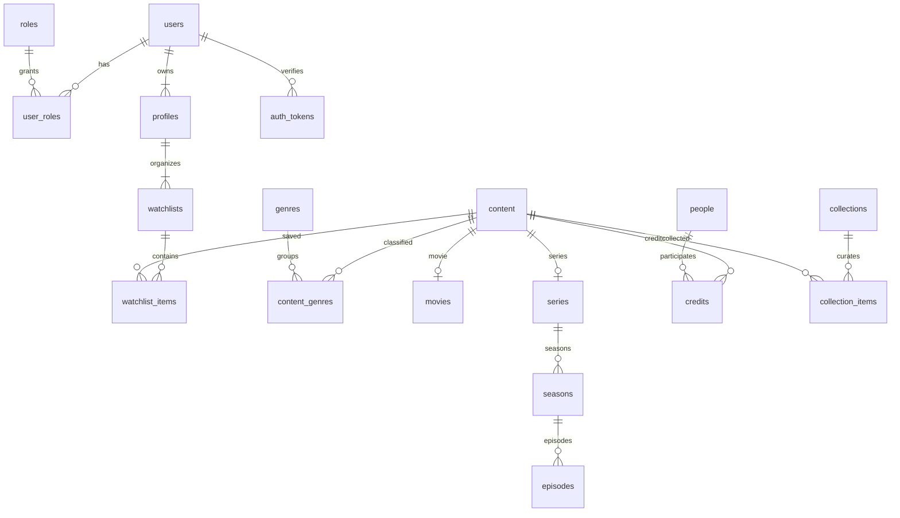

# Database model

Flyway V1 creates the phase 1 schema. Referential integrity, uniqueness and ordered catalog indexes are enforced in PostgreSQL. All ID-bearing domain records use UUIDs. Timestamps use timestamptz. Catalog reads are limited to 12 items; administration lists cap at 200.

Additional phase 1 tables: audit_logs, rate_limits, mail_outbox, spring_session and spring_session_attributes. Verification/reset tokens are stored as SHA-256 digests and consumed with an atomic DELETE RETURNING. Email outbox bodies temporarily contain the delivery link; successful sends redact them and records expire after seven days. Locking prevents multiple workers delivering the same row concurrently; SMTP delivery remains at-least-once if the process fails after sending.

## Planned migrations (not implemented)

Phase 2: media_assets(content_id, storage_key, checksum, source dimensions, status), media_renditions(asset_id, bitrate, dimensions, manifest_key), subtitles(asset_id, language, storage_key), processing_jobs(asset_id, attempts, status, error, timings), playback_sessions(profile_id, asset_id, started/ended), watch_progress(profile_id, content_id, position, updated_at; unique profile/content).

Phase 3: embeddings(content_id, model_version, vector), ratings(profile_id, content_id, score), recommendation_feedback(profile_id, content_id, reason), genre_preferences. Enable pgvector only when its model/dimension contract is established. Use indexed full-text search plus vector retrieval; never generate catalog entries.

Phase 4: watch_parties(host_profile_id, content_id, expires_at), party_members(party_id, profile_id), party_messages(party_id, sender_id, body). Redis stores ephemeral presence and playback clocks; PostgreSQL stores durable membership and moderation records. Match groups need participant preferences and votes with unique voter/candidate keys.

Phase 5: viewing_events, versioned transactional_outbox and consumed_events (unique consumer/event id) for retry-safe Kafka consumers. Add source-measured aggregates only after events exist.
