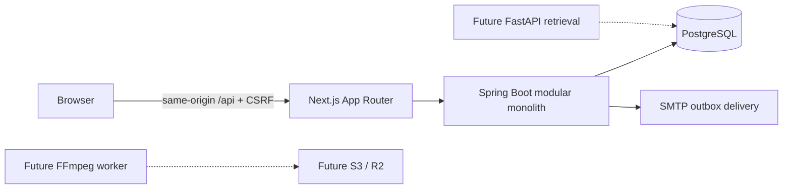

# Architecture

VYBE starts as a modular monolith. Next.js is the presentation layer; same-origin `/api` rewrites forward to Spring Boot. PostgreSQL is the authoritative store. Spring Session JDBC provides revocable sessions across instances. The browser keeps only a non-secret selected profile ID; every profile operation verifies ownership on the server.

Modules: identity (credentials, verification, sessions), users (account), profiles (viewing identities), catalog (metadata), watchlists (saved content), administration (catalog writes/audit), notifications (durable mail outbox). Later modules are documented boundaries, not empty services presented as implementations.

JPA owns identity entities; JDBC read models serve catalog joins and bounded pagination. Explicit SQL is intentional for predictable catalog queries. Transactions surround business writes. Flyway alone owns schema changes. No shared entity objects cross the HTTP boundary.

Deploy web and API behind the same-origin proxy; API should not be called cross-origin from the browser. TLS terminates at the host. Use a private network for Postgres; forwarded headers are disabled unless the proxy boundary is trusted.
